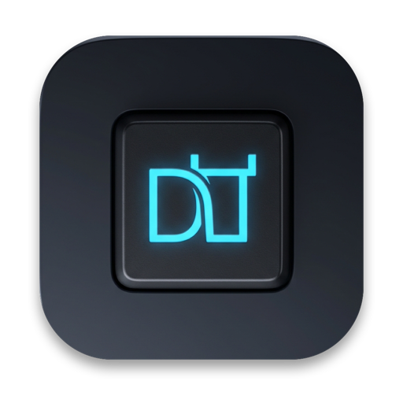

<p align="center">
  
</p>

<h1 align="center">Dopishi</h1>

<p align="center">
  <strong>On-device AI writing copilot, real-time typo & layout auto-corrector, smart typography engine, and instant keyboard switcher for macOS.</strong>
</p>

<p align="center">
  <strong>English</strong> | <a href="README.ru.md">Русский</a>
</p>

<p align="center">
  <a href="https://github.com/luksiko/dopishi/actions/workflows/build.yml"></a>
  <a href="https://github.com/luksiko/dopishi/releases/latest"></a>
  <a href="https://www.apple.com/macos/"></a>
  <a href="https://swift.org/"></a>
  
  <a href="LICENSE"></a>
</p>

---

## Overview

**Dopishi** is a native macOS menu bar writing assistant and keyboard powerhouse. It combines an **in-process Apple Silicon Metal LLM engine (`llama.cpp`)** for instant ghost-text completions with **real-time mechanical typo correction**, **automatic wrong-layout recovery**, **smart punctuation**, and **zero-latency single-key layout switching** — all running 100% locally on your Mac with zero cloud calls.

---

## Quick Install

### Homebrew

Install with a single command via [Homebrew](https://brew.sh):

```bash
brew install --cask luksiko/tap/dopishi
```

*(To update: `brew upgrade --cask dopishi`)*

### Direct Download (DMG)

<p align="left">
  <a href="https://github.com/luksiko/dopishi/releases/latest">
    
  </a>
</p>

1. Download **[Dopishi.dmg](https://github.com/luksiko/dopishi/releases/latest)** (Universal binary for Apple Silicon M1–M4 and Intel).
2. Drag **Dopishi** to your **Applications** folder.
3. Launch Dopishi and grant **Accessibility** permissions when prompted.

---

## Key Features

### ✨ 1. On-Device AI Autocompletion (Apple Silicon Metal)
* **Native In-Process Metal Inference:** Runs quantized GGUF models (Gemma 4, Qwen 2.5, SmolLM2, or any custom GGUF) directly in-process via Metal GPU acceleration — no Python, Ollama, or external servers required.
* **Ghost-Text & Floating HUD:** Suggests natural 1–4 word continuations as you type. Accept with `Tab`, `→`, or a custom shortcut, or accept word-by-word.
* **Prefix KV Caching & Token Stitching:** Reuses KV-cache state across keystrokes and stitches tokens when you keep typing matching characters, delivering sub-50 ms responsiveness.
* **Screen & App Context Awareness:** Understands the active app, window title, web domain (GitHub, Jira, Linear, Notion, Google Docs), and visible chat context (with native Vision OCR fallback) to adapt tone and terminology.
* **Personal Vocabulary & Writing Personas:** Learns your frequent phrases locally in SQLite and supports custom style instructions.
* **Smart Replies & Built-in Model Profiler:** Generates one-tap contextual replies to incoming messages and includes a 5-stage live benchmark to grade speed, accuracy, and language compliance of any model.
* **Adaptive Battery Eco Mode:** Automatically scales token budgets or pauses inference when running on battery power.

### 🛠 2. Real-Time Typo, Layout & Punctuation Auto-Correction
* **Mechanical Typo Correction on the Fly:** Fixes adjacent transposed letters (`привте` → `привет`, `hte` → `the`), accidental fat-finger extra keys (`большоей` → `большой`, `поставитьл` → `поставить`), single missing letters (`больой` → `большой`), and physically adjacent key substitutions (`привкт` → `привет`).
* **Automatic Wrong-Layout Correction:** Type `ghbdtn ` in English layout and Dopishi seamlessly replaces it with `привет ` and switches your active layout automatically.
* **Smart Punctuation & Typography:**
  * Double-space to period (`. `) and automatic sentence/paragraph capitalization.
  * Automatic comma insertion before Russian conjunctions `а` and `но` in mid-sentence.
  * Smart typography: converts `--` to em-dash (`—`), `...` to ellipsis (`…`), and removes accidental spaces before punctuation marks.
  * Accidental `cAPS lOCK` correction (`hELLO` → `Hello`) and inline emoji shortcodes (`:fire:` / `:огонь:` → 🔥).
* **Instant Synonym & Thesaurus Popup:** Double-tap Option or invoke the thesaurus HUD on any word to replace it with context-fitting synonyms.

### ⌨️ 3. Smart Conversion (`⇧⇧`) & Single-Key Layout Switching
* **Greedy Line Conversion (`⇧⇧` Double-Shift):** Typed several words in the wrong layout? Double-tap `Shift` (or your custom hotkey). Dopishi scans backwards from the caret, finds the exact boundary where the wrong layout started, and converts only that segment.
* **Zero-Latency Single-Key Layout Switch:** Switch input sources with a lone tap of Right `⌥ Option`, `⇪ Caps Lock`, Right `⌘ Command`, or `Fn` — without interfering with key combinations (`⌘C`, `⌥←`, etc.).
* **Thought Recovery HUD:** Shows a non-intrusive floating preview of your last typed fragment when you switch layouts mid-thought.
* **Physical Key Matrix Mapping:** Maps keys by physical hardware coordinates across 🇺🇸 English, 🇷🇺 Russian, 🇺🇦 Ukrainian, 🇩🇪 German (QWERTZ), 🇫🇷 French (AZERTY), and 🇪🇸 Spanish layouts.

---

## 🔒 Privacy & Security by Design

* **100% Local Processing:** All layout conversion, typo correction, spellchecking, and LLM inference happen strictly on your Mac. The only network activity is optional model downloading from Hugging Face and Sparkle update checks.
* **Zero Keylogging:** Buffers exist only in volatile RAM for the current word/sentence context.
* **Hardware-Level Secure Field Protection:** Automatically detects password inputs (`AXSecureTextField`), terminal prompts, and excluded apps, immediately disabling all text inspection and AI features.
* **Per-App Control:** Customize or disable auto-correction and AI completions for any individual application.

---

## Build & Test from Source

### Requirements
* macOS 13.0 (Ventura) or later
* Xcode 15.0 or later

```bash
# 1. Clone the repository
git clone https://github.com/luksiko/dopishi.git
cd dopishi

# 2. Run the automated test suite (600+ unit & integration tests)
bash scripts/test.sh

# 3. Package a signed Universal release (DMG + ZIP)
bash scripts/package-release.sh 1.5.1
```

---

## Support the Project

Dopishi is free and open source. If it saves you time every day, consider supporting its development:

| Network | Address |
|:---|:---|
| **Ethereum / Arbitrum / Base** | `0x30c8b011AF68a963694Ce1E5f54A545442acFEfA` |
| **Bitcoin** | `bc1qtqm7rgma8dcgqc50lmzmyxn729yqrtf9zs7asx` |
| **Solana** | `A4jzTGxP7tbhyDFrcWJKdsA8v5xUwF6UzvC7RFmDRrfi` |
| **Tron (USDT)** | `TDAyNkS36eKyqv9s4KQpu4ebWciQ2bqdW3` |

---

## License

Released under the [MIT License](LICENSE). Originally evolved from an early fork of [langSwitcher](https://github.com/reg2005/langSwitcher).
