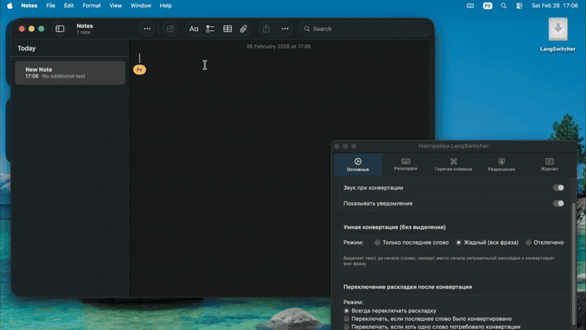

<p align="center">
  
</p>

<h1 align="center">Dopishi (Допиши)</h1>

<p align="center">
  <strong>Умный переключатель раскладки клавиатуры и мгновенный конвертер текста для macOS с открытым исходным кодом и уважением к приватности.</strong>
</p>

<p align="center">
  <a href="README.md">English</a> | <strong>Русский</strong>
</p>

<p align="center">
  <a href="https://github.com/luksiko/dopishi/actions/workflows/build.yml"></a>
  <a href="https://www.apple.com/macos/"></a>
  <a href="https://swift.org/"></a>
  
  
  <a href="LICENSE"></a>
</p>

---

<p align="center">
  
</p>

---

## Быстрая установка

### Homebrew

Установите одной командой через [Homebrew](https://brew.sh):

```bash
brew install --cask luksiko/tap/dopishi
```

*(Для обновления: `brew upgrade --cask dopishi`)*

### Прямая загрузка (DMG)

Предпочитаете стандартный установщик macOS?

<p align="left">
  <a href="https://github.com/luksiko/dopishi/releases/latest">
    
  </a>
</p>

1. Скачайте **[Dopishi.dmg](https://github.com/luksiko/dopishi/releases/latest)** под ваш процессор (Apple Silicon M1/M2/M3/M4 или Intel).
2. Перетащите **Dopishi** в папку **Программы** (`/Applications`).
3. Запустите Dopishi и выдайте разрешение **Accessibility** (Универсальный доступ) в системных настройках.

---

## Зачем нужен Dopishi?

Каждый из нас попадал в эту ситуацию: увлечённо набираешь мысль или комментарий к коду, поднимаешь глаза на экран — а там `ghbdtn rfr ltkf lheu` вместо `привет как дела друг`.

Dopishi навсегда избавляет от этого раздражения. Приложение тихо живёт в строке меню, потребляет менее 30 МБ оперативной памяти и ставит вашу цифровую безопасность превыше всего.

### ⚡ Три суперсилы Dopishi

* **1. Автокоррекция на лету:**
  Печатаете `ghbdtn ` — и Dopishi сам на лету превращает его в `привет ` прямо под курсором. Без лишних нажатий клавиш.
* **2. Умная конвертация (`⇧⇧` Двойной Shift):**
  Набрали целое предложение не в той раскладке? Нажмите дважды `Shift` (или вашу комбинацию клавиш). Dopishi определит границу ошибки и конвертирует именно ошибочную часть.
* **3. Переключение раскладки одной клавишей:**
  Переключайте системный язык коротким одиночным нажатием правого `⌥ Option` или `⇪ Caps Lock`. Мгновенный отклик без системных задержек macOS.

---

## 🔒 Приватность и безопасность

Клавиатурные утилиты требуют доступ к системному **Accessibility API**, поэтому вопрос доверия здесь первостепенен:

* **100% Офлайн:** У Dopishi **нет сетевых разрешений**, приложение не делает ни одного интернет-запроса.
* **Никакого кейлоггинга:** Приложение не логирует и не сохраняет ваш ввод.
* **Защита паролей:** Dopishi аппаратно определяет защищённые поля ввода (пароли, PIN-коды) и полностью отключает обработку текста при нахождении в них.
* **Локальный журнал SQLite:** История конвертаций **отключена по умолчанию**. Если вы её включите, данные хранятся исключительно локально (`~/Library/Application Support/Dopishi/`) и могут быть стёрты в один клик.
* **Прозрачный открытый исходный код:** Чистый нативный Swift 5 без закрытых сторонних библиотек и трекеров.

---

## Как это работает

В отличие от примитивных словарей, Dopishi сопоставляет символы по **координатам физических клавиш** (матрица QWERTY):

```
Ввод:   "ghbdtn" (набрано на английской раскладке вместо русской)
1. Автоопределение исходного языка: US QWERTY
2. Определение физических позиций клавиш: [g, h, b, d, t, n] -> [0x05, 0x04, 0x0B, 0x02, 0x11, 0x2D]
3. Сопоставление с активной целевой раскладкой: Русская ЙЦУКЕН
4. Результат: "привет"
```

Все знаки пунктуации (`?`, `!`, `/`, `@`) и цифры сохраняются в точности.

### Поддерживаемые раскладки

Dopishi автоматически подтягивает активные раскладки из ваших **Системные настройки > Клавиатура > Источники ввода**:
* 🇺🇸 **Английская** (U.S., ABC, QWERTY)
* 🇷🇺 **Русская** (ЙЦУКЕН)
* 🇺🇦 **Украинская**
* 🇩🇪 **Немецкая** (QWERTZ)
* 🇫🇷 **Французская** (AZERTY)
* 🇪🇸 **Испанская** (QWERTY)

---

## Настройки

Dopishi не мозолит глаза и живёт в строке меню. Нажмите `⌘,` или иконку в меню-баре для тонкой настройки:

<p align="center">
  
</p>

* **Режимы Умной конвертации:**
  * **Жадная строка (Рекомендуется):** Автоматически находит, где началась неправильная раскладка, и конвертирует только нужную часть.
  * **Последнее слово:** Конвертирует только последнее слово перед курсором.
  * **Только выделение:** Работает строго с вручную выделенным текстом.
* **Клавиша переключения языка:** Правый `⌥ Option`, `⇪ Caps Lock`, правый `⌘ Command` или `Fn`.
* **Горячие клавиши:** Можно использовать двойной Shift или записать собственное глобальное сочетание.
* **Звук и уведомления:** Приятный ненавязчивый звуковой сигнал при успешной конвертации.

---

## Сборка из исходников

### Требования

* macOS 13.0 (Ventura) или новее
* Xcode 15.0 или новее

```bash
# 1. Клонируйте репозиторий
git clone https://github.com/luksiko/dopishi.git
cd dopishi

# 2. Запустите тесты (440+ тестов проверяют маппинг и эвристики)
bash scripts/test.sh

# 3. Соберите релизный бинарник (Universal: Apple Silicon + Intel)
xcodebuild -project LangSwitcher.xcodeproj \
  -scheme LangSwitcher \
  -configuration Release \
  -derivedDataPath build \
  -arch arm64 -arch x86_64 \
  ONLY_ACTIVE_ARCH=NO \
  CODE_SIGN_IDENTITY="-" \
  CODE_SIGNING_REQUIRED=NO \
  CODE_SIGNING_ALLOWED=NO \
  build

# Готовое приложение будет в:
# build/Build/Products/Release/Dopishi.app
```

---

## Участие в разработке (Contributing)

Мы рады контрибьютам! Если вы хотите добавить новую раскладку, улучшить эвристики словарей или добавить язык интерфейса:

1. Сделайте Fork репозитория и создайте ветку под вашу фичу.
2. Убедитесь, что тесты проходят: `bash scripts/test.sh`.
3. Отправьте Pull Request с понятным описанием изменений.

---

## Благодарности и истоки проекта

* **Истоки:** Dopishi создан на основе замечательного проекта [langSwitcher](https://github.com/reg2005/langSwitcher) от [reg2005](https://github.com/reg2005). Мы выражаем искреннюю признательность и уважение автору за открытый код, заложенный фундамент и вдохновение.
* **Идея:** Вдохновлён легендарными утилитами [Caramba Switcher](https://caramba-switcher.com/mac) и [Punto Switcher](https://yandex.ru/soft/punto/), но создан как полностью нативный, открытый и безопасный инструмент без подписок и телеметрии.

---

## Поддержать проект

Dopishi — бесплатный проект с открытым исходным кодом. Если приложение экономит вам время и нервы каждый день, вы можете поддержать его развитие:

### Перевод картой РФ
👉 **[Перевод через Т-Банк](https://www.tbank.ru/cf/66tz0unG7b7)**

### Криптовалюта

| Сеть | Адрес |
|:---|:---|
| **Ethereum / Arbitrum / Base** | `0x30c8b011AF68a963694Ce1E5f54A545442acFEfA` |
| **Bitcoin** | `bc1qtqm7rgma8dcgqc50lmzmyxn729yqrtf9zs7asx` |
| **Solana** | `A4jzTGxP7tbhyDFrcWJKdsA8v5xUwF6UzvC7RFmDRrfi` |
| **Tron (USDT)** | `TDAyNkS36eKyqv9s4KQpu4ebWciQ2bqdW3` |

---

## Лицензия

Распространяется под свободной лицензией [MIT](LICENSE). Разрешено бесплатное личное и коммерческое использование.
